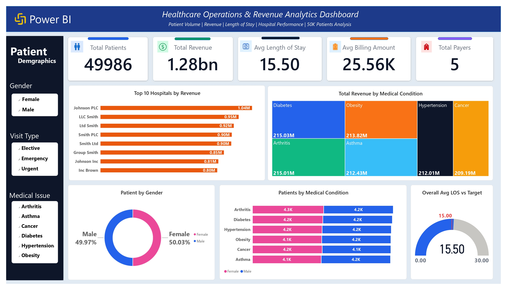

# 🏥 Healthcare Operations & Revenue Analytics — SQL Server & Power BI

## 📌 Project Overview
**End-to-end healthcare operations analysis of 55,501 patient records (2019–2024)** — from SQL Server data cleaning, deduplication, and revenue aggregation to an interactive Power BI dashboard tracking patient volume, hospital revenue, length of stay, and medical-condition performance.

## The Analysis Covers:
- [Business Problem](#business-problem)
- [Dataset Overview](#dataset-overview)
- [Tech Stack](#tech-stack)
- [What This Project Does](#what-this-project-does)
- [Key Insights](#key-insights)
- [My Process](#my-process)
- [SQL Queries](#sql-queries)
- [DAX Measures](#dax-measures)
- [Repository Structure](#repository-structure)
- [How to Run](#how-to-run)
- [Skills Demonstrated](#skills-demonstrated)
- [Results & Conclusion](#results-conclusion)
- [Author](#author)
---
<br>

[](https://www.linkedin.com/in/hafiz-arslan-shafique-bc240203664/)
[](https://github.com/Hafiz-Arslan-Shafique)
[](https://mail.google.com/mail/?view=cm&fs=1&to=hafizarslan3195@gmail.com)
[](tel:+966579594038)



---

<a id="business-problem"></a>
## 🧩 Business Problem
Healthcare operations teams sit on huge volumes of patient, billing, and hospital data — but without a validated, deduplicated view of that data, revenue and performance figures can't be trusted. **Operations leadership needs one reliable analytical layer** that tracks patient volume, hospital revenue, length of stay, and medical-condition costs, so operational and financial decisions are based on clean data rather than raw, duplicated, or error-filled records.

---

<a id="dataset-overview"></a>
## 🗂️ Dataset Overview
The dataset contains **55,501 patient records spanning 2019–2024**, including:
- Patient name, age, gender, blood type
- Medical condition
- Admission and discharge dates
- Doctor and hospital
- Insurance provider
- Billing amount
- Room number
- Admission type (**Emergency, Urgent, Elective**)
- Medication
- Test results (**Normal, Abnormal, Inconclusive**)

---

<a id="tech-stack"></a>
## 🧰 Tech Stack
- **SQL Server (T-SQL)** — data validation, cleaning, deduplication, and revenue analysis
- **Power BI** — interactive dashboard design and visualization
- **Power BI Desktop / PBIX** — report modeling and KPI measures
- **GitHub** — version control and portfolio hosting

---

<a id="what-this-project-does"></a>
## 🎯 What This Project Does
Raw healthcare records rarely arrive analysis-ready — duplicate admissions, missing dates, and negative billing values can quietly distort revenue and volume figures. I used **SQL Server** to validate, clean, and deduplicate a 55,501-row healthcare dataset down to a trustworthy reporting table, then built an **interactive Power BI dashboard** so operations stakeholders can explore patient volume, revenue, and length-of-stay performance themselves.

| | |
|---|---|
| **Patients Analyzed** | 49,986 (post-cleaning) |
| **Total Revenue** | 1.28bn |
| **Avg Length of Stay** | 15.50 days (Target: 15.00) |
| **Highest-Revenue Hospital** | Johnson PLC (1.04M) |
| **Highest-Revenue Condition** | Diabetes (215.03M) |
| **Tools** | SQL Server, T-SQL, Power BI, DAX, Power BI Desktop |

---

<a id="key-insights"></a>
## 💡 Key Insights
- **Diabetes generates the highest medical-condition revenue** at 215.03M, while Cancer sits lowest at 209.19M — a relatively narrow spread, showing revenue is distributed fairly evenly across the major conditions rather than concentrated in one.
- **Gender split is almost perfectly balanced** — Female patients at 50.03% vs. Male at 49.97% — so condition-level and revenue patterns aren't being driven by a demographic skew.
- **Patient volume is tightly clustered across conditions**, with each condition/gender segment sitting in the 4.1K–4.3K range, meaning no single condition dominates hospital caseload.
- **Johnson PLC leads hospital revenue** at 1.04M, followed by LLC Smith at 0.95M — a useful starting point for benchmarking what top-performing hospitals are doing differently.
- **Average length of stay runs 0.50 days above target** (15.50 vs. 15.00), a small but consistent gap worth investigating for throughput or discharge-process improvements.

---

<a id="my-process"></a>
## 🛠️ My Process
1. **Loaded and verified the raw dataset** into SQL Server, confirming row counts before any cleaning began.
2. **Standardized and cleaned the data** — trimmed and uppercased patient names, calculated length of stay via `DATEDIFF`, and excluded records with missing admission/discharge dates or negative length of stay.
3. **Detected and removed duplicate records** using a `ROW_NUMBER()` window function partitioned by patient name and admission date, keeping one clean record per patient visit.
4. **Validated data quality** — checked for NULLs, inconsistent categories, and numerical outliers across age, billing, and length of stay.
5. **Corrected negative billing values** by converting them to positive amounts with `ABS()`, then re-verified the fix.
6. **Built business-facing SQL aggregations** — revenue and patient volume by medical condition, insurance provider, admission type, and top-performing hospitals.
7. **Modeled and visualized results in Power BI**, translating the cleaned SQL table into KPI cards, a hospital revenue ranking, a condition-revenue treemap, and an LOS-vs-target gauge.

<a id="sql-queries"></a>
<details>
<summary><b>📂 See full SQL queries with explanations</b></summary>

### 1. Data Cleaning & Length of Stay
```sql
SELECT
    UPPER(TRIM(Name)) AS Clean_Name,
    Age,
    Gender,
    Blood_Type,
    Medical_Condition,
    Date_of_Admission,
    Discharge_Date,
    DATEDIFF(DAY, Date_of_Admission, Discharge_Date) AS Length_of_Stay,
    Hospital,
    Insurance_Provider,
    Billing_Amount,
    Admission_Type,
    Doctor,
    Medication,
    Test_Results,
    Room_Number
INTO Clean_Healthcare
FROM Healthcare_Operations
WHERE Date_of_Admission IS NOT NULL
  AND Discharge_Date IS NOT NULL
  AND DATEDIFF(DAY, Date_of_Admission, Discharge_Date) >= 0;
```
**Purpose:** Creates the cleaned analytical table — standardizes patient names, calculates length of stay, and excludes records with missing dates or a negative LOS.

### 2. Duplicate Detection
```sql
SELECT
    Clean_Name,
    Date_of_Admission,
    COUNT(*) AS Duplicates
FROM Clean_Healthcare
GROUP BY Clean_Name, Date_of_Admission
HAVING COUNT(*) > 1;
```
**Purpose:** Flags duplicate patient/admission combinations before they can distort patient counts or revenue totals.

### 3. CTE + ROW_NUMBER Deduplication
```sql
WITH Deduped AS (
    SELECT *,
        ROW_NUMBER() OVER (
            PARTITION BY Clean_Name, Date_of_Admission
            ORDER BY Discharge_Date
        ) AS rn
    FROM Clean_Healthcare
)
SELECT
    Clean_Name, Age, Gender, Blood_Type, Medical_Condition,
    Date_of_Admission, Discharge_Date, Length_of_Stay,
    Hospital, Insurance_Provider, Billing_Amount,
    Admission_Type, Doctor
INTO Final_Healthcare
FROM Deduped
WHERE rn = 1;
```
**Purpose:** Builds the final, deduplicated reporting table — one clean record per patient visit — using a CTE with a `ROW_NUMBER()` window function.

### 4. NULL Validation
```sql
SELECT
    SUM(CASE WHEN Clean_Name IS NULL THEN 1 ELSE 0 END) AS Null_Name,
    SUM(CASE WHEN Age IS NULL THEN 1 ELSE 0 END) AS Null_Age,
    SUM(CASE WHEN Billing_Amount IS NULL THEN 1 ELSE 0 END) AS Null_Billing,
    SUM(CASE WHEN Hospital IS NULL THEN 1 ELSE 0 END) AS Null_Hospital,
    SUM(CASE WHEN Length_of_Stay IS NULL THEN 1 ELSE 0 END) AS Null_LOS
FROM Final_Healthcare;
```
**Purpose:** Confirms the cleaned table is free of NULLs in the fields that matter most for reporting.

### 5. Negative Billing Correction
```sql
SELECT COUNT(*) AS Negative_Bills
FROM Final_Healthcare
WHERE Billing_Amount < 0;

UPDATE Final_Healthcare
SET Billing_Amount = ABS(Billing_Amount)
WHERE Billing_Amount < 0;

SELECT COUNT(*) AS Negative_Bills_After_Fix
FROM Final_Healthcare
WHERE Billing_Amount < 0;
```
**Purpose:** Detects, corrects, and re-verifies invalid negative billing values — a common data-entry error in raw healthcare billing data.

### 6. Medical-Condition Revenue Analysis
```sql
SELECT
    Medical_Condition,
    COUNT(*) AS Patient_Count,
    SUM(Billing_Amount) AS Total_Revenue,
    AVG(CAST(Billing_Amount AS FLOAT)) AS Avg_Revenue,
    AVG(CAST(Length_of_Stay AS FLOAT)) AS Avg_LOS
FROM Final_Healthcare
GROUP BY Medical_Condition
ORDER BY Total_Revenue DESC;
```
**Purpose:** Ranks medical conditions by revenue, patient volume, and average length of stay — feeding the dashboard's condition-revenue treemap.

### 7. Top 10 Hospitals by Revenue
```sql
SELECT TOP 10
    Hospital,
    COUNT(*) AS Patient_Count,
    SUM(Billing_Amount) AS Total_Revenue,
    AVG(CAST(Billing_Amount AS FLOAT)) AS Avg_Bill
FROM Final_Healthcare
GROUP BY Hospital
ORDER BY Total_Revenue DESC;
```
**Purpose:** Surfaces the highest-revenue hospitals — the single most actionable query for benchmarking hospital performance.

</details>

<a id="dax-measures"></a>
<details>
<summary><b>📊 See Power BI DAX measures</b></summary>

The supplied PBIX model references the following measures, built on the `Final_Healthcare` table:

```DAX
Total Patients
Total Revenue
Avg Length of Stay
Avg Billing Amount
Total Payers
```
*(Only measure names are exposed in the supplied PBIX model layout; the underlying DAX formulas were not included in the supplied project materials, so they are not reproduced here.)*

</details>

---

<a id="repository-structure"></a>
## 📁 Repository Structure
```text
healthcare-operations-sql-powerbi/
├── 01_sql_queries/
│   └── healthcare_operations_analysis.sql
├── 02_powerbi_file/
│   └── healthcare_operations_dashboard.pbix
├── 03_dashboard_images/
│   └── healthcare_operations_dashboard.jpg
├── 04_dataset/
│   └── healthcare_operations_dataset.csv
├── Final Report.pdf
└── README.md
```

---

<a id="how-to-run"></a>
## 🚀 How to Run
**SQL Server:** Open SSMS → create/select database `HealthcareDB` → import the dataset into a raw table → run `healthcare_operations_analysis.sql` in order to produce `Clean_Healthcare` and `Final_Healthcare`.
**Power BI:** Open `healthcare_operations_dashboard.pbix` → update the data source if needed → click **Refresh** → explore via the Gender, Visit Type, and Medical Issue slicers.

---

<a id="skills-demonstrated"></a>
## 🎓 Skills Demonstrated
**SQL Server:** Data validation, text standardization, `DATEDIFF` calculations, CTEs, `ROW_NUMBER()` and `PARTITION BY` window functions, duplicate detection, NULL and category validation, `CASE`-based conditional aggregation, `UPDATE`/`ABS` data correction, `GROUP BY`, `HAVING`, `TOP`
**Power BI:** Dashboard design, KPI cards, DAX measures, treemap and gauge visuals, interactive slicers
**Analytical thinking:** Turning a large, unvalidated raw dataset into a clean, trustworthy reporting layer and a business-ready operational dashboard

---

<a id="results-conclusion"></a>
## 🏁 Results & Conclusion
This analysis directly answers the business problem: **can operations leadership trust the data behind patient volume, revenue, and length-of-stay reporting — and where should attention go first?**
- **The cleaning and deduplication layer is the project's core value.** Turning 55,501 raw rows into a validated `Final_Healthcare` table — free of duplicate visits, missing dates, and negative billing — means every downstream revenue and volume figure can be trusted.
- **Length of stay is the clearest operational flag.** At 15.50 days against a 15.00-day target, the 0.50-day gap is small but consistent, and is a natural starting point for a throughput or discharge-process review.
- **Hospital revenue is led by Johnson PLC (1.04M) and LLC Smith (0.95M)**, giving operations a concrete starting point for benchmarking what top-performing hospitals are doing differently from the rest.
- **Revenue is spread evenly across medical conditions** (209M–215M range), so there's no single-condition cost driver — cost-control efforts are better aimed at hospital- or LOS-level inefficiencies than any one diagnosis.
**Bottom line:** with a validated data layer now in place, the healthcare operations team can move from reactive reporting to proactive monitoring — tracking LOS against target, watching hospital revenue rankings, and catching data-quality issues (duplicates, negative billing) before they reach a report.

---

<a id="author"></a>
## 👨‍💻 Author
**Hafiz Arslan Shafique**
Data Analyst | SQL Server · Power BI · Excel
📧 [Email](https://mail.google.com/mail/?view=cm&fs=1&to=hafizarslan3195@gmail.com) · 💼 [LinkedIn](https://www.linkedin.com/in/hafiz-arslan-shafique-bc240203664/) · 🗂️ [GitHub](https://github.com/Hafiz-Arslan-Shafique) · 📞 Phone: +966 57 959 4038
